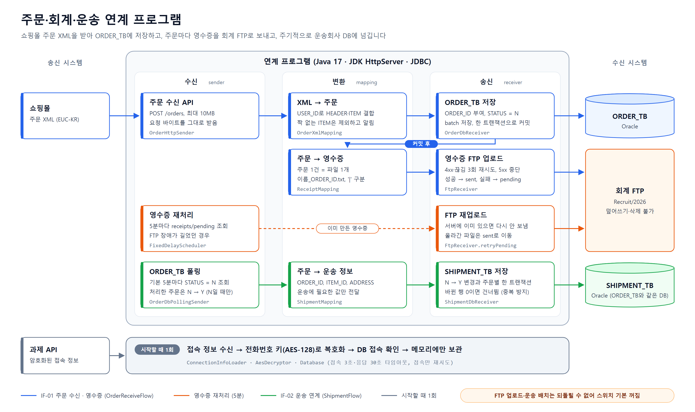
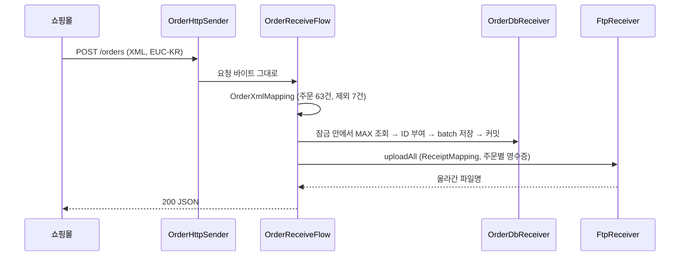
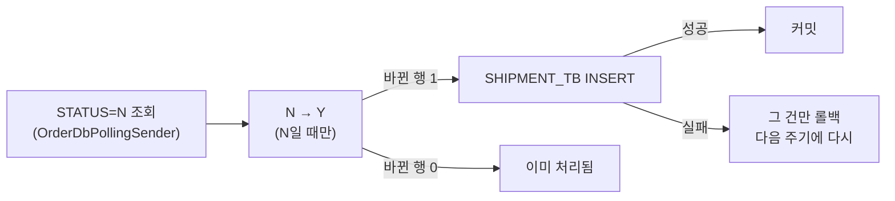

# 주문·회계·운송 연계 프로그램


인스피언 과제: 쇼핑몰 주문 XML을 받아 DB에 저장하고, 주문마다 영수증을 회계 FTP에 올리고, 주기적으로 운송회사 DB에 넘깁니다.
HTTP 서버·스케줄러·트랜잭션은 JDK 기본 기능으로 만들었고, 외부 라이브러리는 4개(Jackson, Commons Net, SLF4J+Logback, Oracle JDBC)만 씁니다.

## 한눈에 보기



| 요구사항 | 구현 |
|---|---|
| 주문 XML을 받아 DB에 자동 저장 | `POST /orders` → `ORDER_TB` |
| 주문마다 영수증 파일을 FTP에 업로드 | 주문 1건 = 파일 1개 (`안형준_A001.txt`) |
| 주문을 운송회사 DB에 주기적으로 입력 | 기본 5분마다 `ORDER_TB` → `SHIPMENT_TB` |
| 어떤 주문이 어디까지 처리됐는지 확인 | 주문번호 로그, `STATUS`, `receipts/pending·sent` |

## 인터페이스 정의

| ID | 이름 | 송신 → 수신 | 방식 | 실행 | 흐름 클래스 |
|---|---|---|---|---|---|
| IF-01 | 주문 수신·영수증 | 쇼핑몰 → ORDER_TB, 회계 FTP | HTTP(XML, EUC-KR) → JDBC, FTP(txt, UTF-8) | 요청 시 (실시간) | `OrderReceiveFlow` |
| IF-02 | 운송 연계 | ORDER_TB → SHIPMENT_TB | JDBC 폴링 → JDBC | 기본 5분마다 (배치) | `ShipmentFlow` |

패키지도 같은 구분으로 나눴습니다: `sender`(받아 오는 쪽) → `mapping`(형식 변환) → `receiver`(보내는 쪽), 흐름과 트랜잭션 경계는 `flow`.

### 필드 매핑

| 주문 XML | ORDER_TB | 영수증 (`\|` 구분) | SHIPMENT_TB |
|---|---|---|---|
| - | `ORDER_ID` (A001~, 생성) | `ORDER_ID` | `ORDER_ID` |
| - | `APPLICANT_KEY` | - | `APPLICANT_KEY` |
| `HEADER/USER_ID` = `ITEM/USER_ID` | `USER_ID` | `USER_ID` | - |
| `HEADER/NAME` | `NAME` | `NAME` | - |
| `HEADER/ADDRESS` | `ADDRESS` | - | `ADDRESS` |
| `ITEM/ITEM_ID` | `ITEM_ID` | `ITEM_ID` | `ITEM_ID` |
| `ITEM/ITEM_NAME` | `ITEM_NAME` | `ITEM_NAME` | - |
| `ITEM/PRICE` (숫자만) | `PRICE` | `PRICE` | - |
| - | `STATUS` (N → Y) | - | - |
| - | - | - | `SHIPMENT_ID` (A001~, 생성) |

## 핵심 설계

| 고려한 것 | 해결 | 커밋 |
|---|---|---|
| 샘플 XML에 루트가 없고, ITEM이 자기 HEADER 아래 있지 않다 | 루트로 감싸 파싱, 순서가 아니라 USER_ID로 결합. 짝 없는 ITEM은 제외하고 응답에 알림. DOCTYPE(XXE)·`\|`·줄바꿈·HEADER 중복은 400 | [`7096882`](https://github.com/HyungJun-An/inspien-eai/commit/7096882) |
| FTP에 올린 파일은 지울 수 없다 | DB 커밋을 먼저 끝내고 FTP 업로드. FTP가 실패해도 주문은 유지 | [`3400336`](https://github.com/HyungJun-An/inspien-eai/commit/3400336) |
| 업로드 재시도 | FTP 응답 코드로 분기: 4xx·끊김은 즉시 3번 재시도, 5xx·로그인 실패는 중단. 남은 파일은 5분마다 재처리 | [`5fdcc7f`](https://github.com/HyungJun-An/inspien-eai/commit/5fdcc7f) |
| DB 재시도는 어디까지 안전한가 | **접속 단계에만** 재시도. 커밋 중 끊기면 반영 여부를 알 수 없어 다시 하지 않고 드러냄. 타임아웃(접속 3초·응답 30초) | [`c76b9a6`](https://github.com/HyungJun-An/inspien-eai/commit/c76b9a6) |
| 배치가 두 번 돌면 중복 배송 | `STATUS`가 N일 때만 Y로 바꾸고, 바뀐 행이 1일 때만 INSERT (주문마다 한 트랜잭션) | [`1016257`](https://github.com/HyungJun-An/inspien-eai/commit/1016257) |
| 동시 요청에서 ORDER_ID 중복 | MAX 조회 → ID 부여 → 저장 → **커밋까지** 한 잠금 안에서. 동시 요청 테스트로 확인 | [`3400336`](https://github.com/HyungJun-An/inspien-eai/commit/3400336) |
| 스케줄 작업이 예외 한 번에 멈춤 | `ScheduledExecutorService`는 작업에서 예외가 나가면 다음 실행을 조용히 멈춘다 → 감싸서 로그로 남기고 계속 | [`cd3b6ec`](https://github.com/HyungJun-An/inspien-eai/commit/cd3b6ec) |
| DB DELETE 권한이 없어 테스트 데이터를 지울 수 없다 | 실제 Oracle 테스트는 전부 롤백. 실제 샘플로 HTTP부터 운송까지 통합 테스트 | [`1094770`](https://github.com/HyungJun-An/inspien-eai/commit/1094770) |

## 실행

공통 준비: `src/main/resources/application-local.properties` 작성 (git 제외)

```properties
inspien.api.username=...   # 과제 API Basic Auth
inspien.api.password=...
inspien.api.phone=...      # 과제 API 요청에 쓴 전화번호 (복호화 키)
```

### 1. 테스트 데이터로 확인 (DB·FTP에 남지 않음)

과제에서 받은 샘플 주문(`src/test/resources/sample-order.xml`, 63건 + 짝 없는 ITEM 7건)으로 전체 흐름을 돌리고, 끝나면 롤백합니다.

```bash
./gradlew test --tests OrderFlowIntegrationTest   # HTTP 수신 → ORDER_TB → 영수증 → 운송 배치 → SHIPMENT_TB
./gradlew test                                     # 전체 97개
```

### 2. 실제 실행 (DB·FTP에 반영, 되돌릴 수 없음)

```bash
./gradlew run

# 쇼핑몰이 보내는 것처럼 주문 XML(EUC-KR)을 POST
curl -X POST -H "Content-Type: application/xml" \
     --data-binary @src/test/resources/sample-order.xml http://localhost:8080/orders
```

```json
{ "savedOrderIds": ["A001", "..."], "skipped": ["USER16/ITEM64", "..."], "uploadedReceipts": ["안형준_A001.txt", "..."] }
```

- 주문은 보내는 순간 `ORDER_TB`에 저장됩니다(커밋). 계정에 DELETE 권한이 없어 지울 수 없습니다.
- FTP 업로드와 운송 배치는 스위치를 켜야 동작합니다. 꺼져 있으면 영수증은 `receipts/pending`에만 남습니다.
- 시연 순서는 아래 "실제 실행 절차"를 참고하세요.

## 처리 추적

실행할 때마다 `logs/inspien_yyyyMMdd_HHmmss.log`가 생기고, 주문번호로 검색하면 흐름이 보입니다.

```
> findstr A001 logs\inspien_*.log
[A001] 주문 수신 - DB 저장 완료 (USER_ID=USER09, ITEM_ID=ITEM45)
[A001] 영수증 FTP 업로드 완료 (안형준_A001.txt)
[A001] 운송 연계 완료: SHIPMENT_ID=A001
```

---

<details>
<summary><b>IF-01 주문 수신 흐름</b></summary>



- 짝이 되는 HEADER가 없는 ITEM은 이름·주소를 알 수 없어 저장하지 않고 `skipped`로 돌려줍니다.
- 데이터가 하나라도 잘못됐으면 요청 전체를 400으로 돌려보내고 아무것도 저장하지 않습니다.
- 영수증 내용은 헤더 + 주문 1줄, `|` 구분(UTF-8)입니다.

</details>

<details>
<summary><b>IF-02 운송 연계 배치</b></summary>



- 연결 하나로 읽고, 주문 1건마다 한 트랜잭션입니다. ORDER_TB와 SHIPMENT_TB가 같은 DB·계정이라 묶을 수 있습니다.
- DB 연결이 끊기면 이번 주기를 멈추고 남은 주문은 다음 주기에 처리합니다.
- 이전 실행이 끝나고 주기만큼 쉰 뒤 다음 실행(fixed delay)이라 겹치지 않습니다.

</details>

<details>
<summary><b>오류가 났을 때</b></summary>

| 오류 | 동작 |
|---|---|
| 잘못된 XML·데이터 (형식, 태그 누락, 가격, `\|`·줄바꿈, HEADER 중복, DOCTYPE) | 400 `{"message": "..."}`, 아무것도 저장하지 않음 |
| 값이 DB 컬럼보다 김 (ORA-12899 등) | 롤백, 400 (다시 보내도 같으므로) |
| 본문 없음 / 10MB 초과 / POST 아님 / 없는 주소 | 400 / 413 / 405 / 404 |
| DB 접속 실패 (네트워크, 세션 부족) | 1초·2초 쉬고 최대 3번 다시 접속 |
| DB 계정 오류, SQL 오류, ORDER_ID 중복 | 롤백, 500 (내부 메시지는 로그에만) |
| 커밋 중 연결 끊김 | 500 + 저장하려던 ORDER_ID 범위를 ERROR 로그로 (자동 재시도하면 중복 저장 위험) |
| FTP 일시 장애 | 즉시 3번 재시도 → 안 되면 `pending`에 남기고 5분마다 재처리 |
| FTP 영구 실패(권한 등) | 해당 파일만 `pending`에 남고 ERROR 로그 |
| 운송 INSERT 실패 | 그 주문만 롤백(N 유지), 다음 주기에 다시 |
| 과제 API·DB 접속 실패 (시작할 때) | 앱이 시작하지 않음 (주문을 받기 전에 멈춤) |

| 확인할 것 | 어디서 |
|---|---|
| 수신됐는가 | ORDER_TB, 로그 `주문 수신` |
| 영수증이 올라갔는가 | `receipts/sent`(올라감) / `receipts/pending`(남음), FTP 목록 |
| 운송으로 넘어갔는가 | `STATUS='Y'`, SHIPMENT_TB |
| 어디서 실패했는가 | 로그의 WARN / ERROR |

```sql
SELECT ORDER_ID, NAME, ITEM_NAME, PRICE, STATUS FROM ORDER_TB WHERE APPLICANT_KEY = 'AHJ00028' ORDER BY ORDER_ID;
SELECT SHIPMENT_ID, ORDER_ID, ITEM_ID, ADDRESS FROM SHIPMENT_TB WHERE APPLICANT_KEY = 'AHJ00028' ORDER BY SHIPMENT_ID;
```

ORDER_TB에 날짜 컬럼이 없어 처리 시각은 로그 파일명과 FTP 파일 수정 시각으로 확인합니다.

</details>

<details>
<summary><b>설정</b></summary>

| 설정 | 기본값 | 설명 |
|---|---|---|
| `inspien.ftp.upload-enabled` | `false` | 영수증 FTP 업로드 + 5분 재처리. 꺼져 있으면 `receipts/pending`에만 저장 |
| `inspien.shipment.enabled` | `false` | 운송 연계 배치 |
| `inspien.shipment.delay-minutes` | `5` | 운송 연계 배치 주기(분). 시연 때는 `1` |
| `inspien.http.port` | `8080` | 주문 수신 API 포트 |
| `inspien.receipt.dir` | `receipts` | 영수증 로컬 보관 폴더 |

- 시작 로그 끝에 스위치 상태가 나옵니다 (`운송 연계 배치: 꺼짐`, 켜져 있으면 WARN).
- `POST /orders`를 보내면 스위치와 상관없이 ORDER_TB에는 저장됩니다.
- 이름·이메일·APPLICANT_KEY는 `application.properties`, API 계정·전화번호는 `application-local.properties`에 있습니다.

</details>

<details>
<summary><b>동시성</b></summary>

- **ORDER_ID**: MAX 조회 → ID 부여 → 저장 → 커밋을 한 잠금 안에서 합니다. 커밋 전에 잠금을 풀면 다음 요청이 앞 요청의 행을 못 봐서 같은 ID를 만듭니다. 파싱과 FTP는 잠금 밖입니다.
- **SHIPMENT_ID**: 배치 하나만 만들고 실행이 겹치지 않아 잠금이 필요 없습니다.
- **FTP 업로드**: 주문 요청과 재처리가 같은 파일을 동시에 올리지 않도록 `synchronized`.
- HTTP 요청은 스레드 4개가 처리합니다. 서버 1대를 전제로 합니다.

</details>

<details>
<summary><b>테스트 (97개)</b></summary>

| 테스트 | 내용 |
|---|---|
| `OrderXmlMappingTest` | 루트 없는 XML, USER_ID 결합, 짝 없는 ITEM 제외, 형식·태그·가격·구분자·중복·XXE |
| `OrderReceiveFlowTest` | ID 부여, 커밋 후 FTP, DB 실패 시 롤백·FTP 안 함, 오류별 400/500, 동시 요청 ID 중복 없음 |
| `OrderHttpSenderTest` | 실제 서버를 띄워 200/400/404/405/413/500 |
| `FtpReceiverTest`, `FtpReceiverRetryTest` | 재시도 분기, pending/sent (가짜 FTP 서버) |
| `ShipmentFlowTest` | 상태 먼저 변경, 중복 방지, 건별 실패 격리, 연결 끊김 시 주기 중단 |
| `DatabaseTest` | commit·rollback·close 순서, 접속 재시도 분기, 커밋 결과 불명 |
| `FixedDelaySchedulerTest`, `EaiApplicationTest` | 예외 후에도 계속 실행, 겹침 없음, 스위치별 작업 등록 |
| `OrderDbReceiverTest`, `OrderDbPollingSenderTest`, `ShipmentDbReceiverTest` | 과제 Oracle에서 SQL 확인 (롤백) |
| `OrderFlowIntegrationTest` | 실제 샘플 데이터로 HTTP 수신 → DB → 영수증 → 운송 전체 흐름 (롤백) |

실제 Oracle 테스트는 모두 롤백되고, 실제 FTP 업로드는 테스트하지 않습니다(올린 파일을 지울 수 없음).

</details>

<details>
<summary><b>실제 실행 절차</b></summary>

1. `receipts/pending`이 비어 있는지 확인
2. `./gradlew test` 통과 확인
3. 스위치 2개를 `true`로 (시연이면 `inspien.shipment.delay-minutes=1`)
4. `./gradlew run` → 시작 로그에 `켜짐` 두 줄 확인
5. 샘플 주문(`sample-order.xml`)을 `POST /orders`로 1회 → 저장 63, 제외 7, 영수증 63
6. 배치 주기 안에 `운송 연계 배치: 대상 63건, 완료 63건, 건너뜀 0건, 실패 0건` 확인
7. DB 조회, FTP 목록, `receipts/sent` 63개 확인
8. 종료(Ctrl+C) 후 스위치 `false`, 주기 `5`로 되돌림

</details>

<details>
<summary><b>구조와 라이브러리</b></summary>

| 패키지 | 역할 |
|---|---|
| `sender` | 받아 오는 쪽: 주문 수신 API(`OrderHttpSender`, `OrderHttpServer`, `GlobalExceptionHandler`), ORDER_TB 폴링(`OrderDbPollingSender`) |
| `mapping` | 형식 변환: XML → 주문, 주문 → 영수증, 주문 → 운송 |
| `receiver` | 보내는 쪽: ORDER_TB, SHIPMENT_TB, 회계 FTP |
| `flow` | 인터페이스 단위 흐름과 트랜잭션 경계 (IF-01, IF-02) |
| `config` | 설정, 접속 정보 수신·복호화(AES-128 ECB) |
| `common` | 주문 모델, ID 생성(A001~Z999), DB 연결·트랜잭션, 주기 작업 |
| `EaiApplication` | 시작·조립 (생성자로 직접 연결) |

| 라이브러리 | 용도 |
|---|---|
| Oracle JDBC (ojdbc17) | Oracle 연결 |
| Apache Commons Net 3.11.1 | FTP 클라이언트 |
| Jackson 3 | JSON (과제 API 응답, 주문 수신 응답) |
| SLF4J + Logback | 로그 |
| JUnit 5, AssertJ, Mockito | 테스트 |

HTTP 서버(`com.sun.net.httpserver`), HTTP 클라이언트(`java.net.http`), 스케줄러(`ScheduledExecutorService`), JDBC 트랜잭션, XML 파싱(`javax.xml`), AES 복호화(`javax.crypto`)는 JDK 기본 기능입니다.

구조도 원본은 `docs/diagrams/architecture.html`(SVG)이고, 브라우저로 열어 캡처한 것이 `docs/images/architecture.png`입니다.

</details>

<details>
<summary><b>한계</b></summary>

- 서버 1대 전제 (ORDER_ID를 애플리케이션 잠금으로 생성)
- FTP 업로드가 주문 요청 안에서 동기로 실행되어, FTP가 느리면 응답도 느려짐
- 커넥션 풀 없이 요청·배치마다 연결을 새로 엶 (이 규모에선 충분, 요청이 많아지면 풀 필요)
- ORDER_TB에 수신 일시가 없어 날짜 기준 조회는 로그·FTP 파일 시각으로 대신함
- ID는 A001~Z999 (25,974건)까지

</details>
